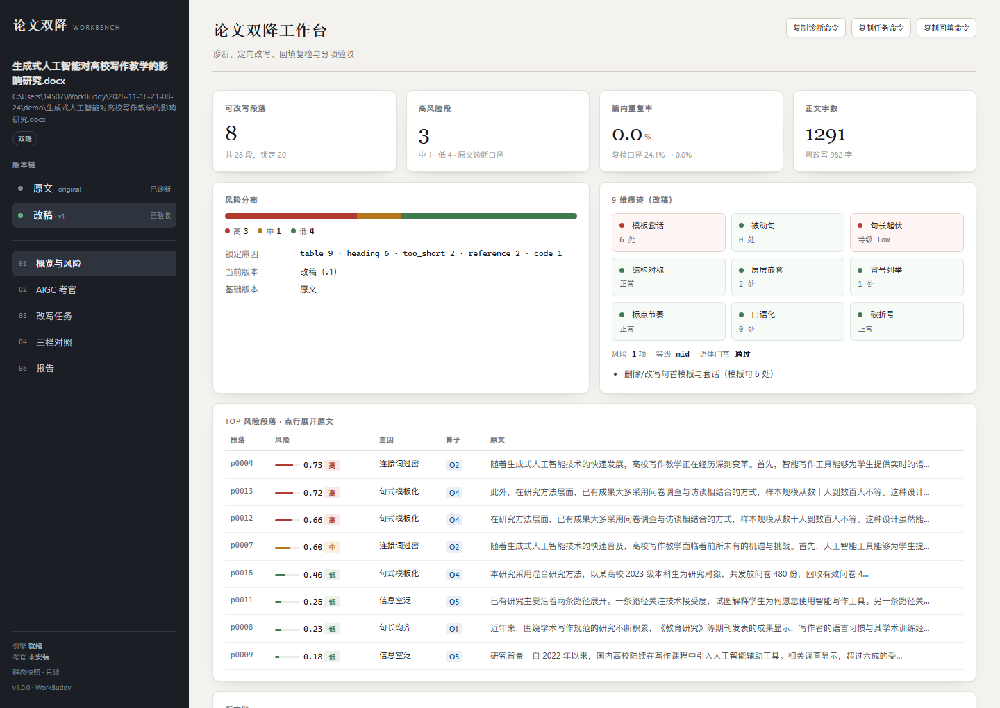

# 论文双降 · WorkBuddy 插件

<p>
  <a href="LICENSE"></a>
  
  <a href="https://github.com/mount9527/WorkBuddy-paper-dual-reducer/releases"></a>
  
  
</p>

> 诊断中文论文的 AI 文风与篇内重复，按段生成改写任务；模型只写 `edits.jsonl`，
> 脚本负责预检、无损回填、复检与回退，并在本机生成一个可预览的工作台。



这是 [paper-dual-reducer](https://github.com/mount9527/paper-dual-reducer)（DSH 插件）的
**WorkBuddy 重写版**：不是把 DSH 插件改名搬过来，而是按 WorkBuddy 的插件模型重新做了一层——
左边栏面板换成技能 + 命令 + 子代理 + 本机工作台，Cordis 宿主路由换成独立 CLI 与本地服务。

| | DSH 版 | 本插件（WorkBuddy） |
|---|---|---|
| 入口 | 左侧栏 React 面板 | 对话里的技能 / 四个命令 / 工作台 HTML |
| 宿主工具 | `ctx.tools.register` 五个工具 | `host/paperdual.py` 子命令，JSON 进 JSON 出 |
| 宿主路由 | Cordis `webServer` 前缀路由 | 静态工作台 + 可选 `serve`（127.0.0.1） |
| 状态 | `~/.dsh/paper-dual` | `~/.workbuddy/paper-dual` |
| 引擎 | 外置目录，需手动配置 | 内置在插件里，装完即用 |
| AIGC 未装依赖 | 回填被判失败并回退 | 结构验收照常通过，明确标注「AIGC 未复检」 |
| 面板与工作台 | 左栏常驻，可拖拽上传 | 生成 HTML 产物，`present_files` 预览；需要点按钮时开本地服务 |

引擎（`engine/`）与 AIGC 考官（`aigc/`）是 MIT 授权的独立组件，按原样内置；
宿主层、工作台、技能、命令、子代理是为 WorkBuddy 新写的。

## 装之前

- **Python ≥ 3.10**（引擎零第三方依赖，只要有标准库）。
- `.doc` 自动转 `.docx`：优先 LibreOffice，其次 Windows 上的 Word COM；都不行时请用户先另存为 `.docx`。
- AIGC 考官（可选）：`torch + transformers`，装在一个单独的 venv 里即可，插件会通过 `config --python` 指向它。
  没装也能诊断、改写、回填，只是不算「AI 疑似占比」。

## 安装

插件走 WorkBuddy 的插件市场分发，仓库根目录就是市场（`.codebuddy-plugin/marketplace.json`），
插件在 `plugins/paper-dual/`。

```bash
# 1) 添加市场
/plugin marketplace add mount9527/WorkBuddy-paper-dual-reducer

# 2) 安装插件
/plugin install paper-dual@paper-dual-workbuddy

# 3) 重新加载
/reload-plugins
```

> 中间那个 `@paper-dual-workbuddy` 是**市场 id**，取自 `.codebuddy-plugin/marketplace.json` 的
> `name` 字段，和仓库名无关——仓库叫 `WorkBuddy-paper-dual-reducer`，市场 id 仍叫
> `paper-dual-workbuddy`。按上面原样复制即可。

本地开发（改代码即时生效）：

```bash
/plugin marketplace add "D:\path\to\WorkBuddy-paper-dual-reducer"
/plugin install paper-dual@paper-dual-workbuddy
/reload-plugins
```

装完侧栏会出现技能 `paper-dual`，命令为 `/paper-dual:diagnose`、`/paper-dual:rewrite`、
`/paper-dual:apply`、`/paper-dual:workbench`，子代理为 `paper-dual-rewriter`。

## 30 秒上手

直接在对话里说：

> 帮我把这篇论文的 AI 味降一降，保留格式：`D:\论文\xxx.docx`

技能会自己走完：自检 → 诊断 → 生成工作台 → 选模式 → 生成任务 → 分批改写 → 回填复检 → 展示对照。

也可以逐步来：

```bash
python "<plugin>/host/paperdual.py" doctor --json
python "<plugin>/host/paperdual.py" diagnose --in "D:\论文\xxx.docx" --json
python "<plugin>/host/paperdual.py" plan --scope aigc --json
python "<plugin>/host/paperdual.py" prompts --limit 6 --skip 0 --json
#   ← 模型按 prompts 写 edits.jsonl
python "<plugin>/host/paperdual.py" apply --json
python "<plugin>/host/paperdual.py" workbench --json
```

## 三个模式

| 模式 | 关注 | 能验什么 |
|---|---|---|
| `dedupe` 降重 | 13 字指纹找「自己抄自己」 | 篇内重复率前后对比（离线） |
| `aigc` 降 AI（默认） | 9 维痕迹诊断 → 写进每条提示词 | 风险项/分数/语体门禁（离线）+ AI 疑似占比（需模型） |
| `both` 双降 | 一次改写同时注入消重与痕迹要求 | 两者分别报告 |

双降不是「跑两遍」，而是同一批提示词里同时写进两类要求；验收时看两边指标。

## 闭环

```text
诊断（只读原文件）
  → 生成任务 prompts.jsonl（每段一条，带原文/约束/文风五条）
  → 模型改写，只写 edits.jsonl（一行一条 {"pid","text","op"}）
  → 预检 lint（六道闸门，逐条告诉你会被哪道拒、怎么改）
  → 回填 finish（格式/实体/锁定区/结构）
  → 复检（9 维不上升、重复率不上升、真机时冻结块 AI 占比不上升）
  → 不过就回退；过了就快照 accepted.docx
```

最多五改：`原文 → 改稿 v1 → 二改 v2 → … → 五改 v5`。第三轮起自动转为
「少量高风险段定向续改」，任务上限递减为 5/3/2。

每一版都保留独立的 `docx / tasks / prompts / edits / lint / verdict / report`，
任意一版都可以作为下一轮基础（`plan --base v2`），也可以单独导出。

## 工作台

```bash
python "<plugin>/host/paperdual.py" workbench --json   # 生成静态 HTML
python "<plugin>/host/paperdual.py" serve --port 8760  # 本地服务，可点按钮
```

五屏：概览与风险、AIGC 考官、改写任务、三栏对照、报告。

- 静态版是快照，只能看与复制；适合 `present_files` 直接预览。
- `serve` 只监听 `127.0.0.1`，提供诊断、生成任务、预检、回填、切版本、下载。
- 两种模式共用同一份 HTML 模板；打开 `#tasks`、`#diff` 这类锚点可直接落到对应屏。

## AIGC 考官（可选）

```bash
python "<plugin>/host/paperdual.py" aigc --json
```

未安装依赖时返回 `AIGC_DEPS_MISSING` 和一整套 PowerShell 安装命令（含国内镜像），
**不会生成也不会显示任何分数**。默认 venv 在 `%USERPROFILE%\paper-dual-aigc`，
`aigc --json` 的 `setup.manualSteps` 会把两条配置命令连同真实路径抄好，照抄即可。安装后：

```bash
python "<plugin>/host/paperdual.py" config --python "%USERPROFILE%\paper-dual-aigc\Scripts\python.exe" --hf-cache "%USERPROFILE%\paper-dual-aigc\hf-cache"
python "<plugin>/host/paperdual.py" aigc --calibrate --json
```

首次标定会联网下载约 409MB 的 `pytorch_model.bin`（模型权重不随插件分发）。
主指标是「可改写正文的 AI 疑似占比」，表格、参考文献、锁定区分开统计；
首版生成 `block-plan.json`，之后所有版本都用同一份冻结块比较。

## 状态与产物

```text
~/.workbuddy/paper-dual/
├─ state.json                 # 文档、版本链、当前版本
├─ config.json                # AIGC 解释器 / 模型缓存 / 标签方向
├─ converted/                 # .doc → .docx 副本（原文件不动）
├─ docs/<文件名>-<哈希>/
│  ├─ original/               # doc.json / profile.json / report.md / source.docx
│  ├─ v1/                     # base.docx / tasks / prompts / edits / lint / rewritten.docx / report.md
│  ├─ v2/ …
│  └─ workbench.html
└─ archive/                   # 原文件变化或重新诊断时的旧产物
```

`PAPER_DUAL_STATE_DIR` 可把整个状态目录重定向到别的磁盘。
产物按「文档路径哈希」隔离，最近 12 篇各自保留；重新诊断同一路径时旧产物进 `archive/`。

## 命令参考

| 命令 | 作用 |
|---|---|
| `doctor` | 环境自检（引擎、状态目录、AIGC 依赖、模板） |
| `status [--doc]` | 当前文档、版本链、AIGC 就绪状态 |
| `diagnose --in <docx> [--force]` | 诊断，只读原文件 |
| `plan [--base] [--scope] [--max-tasks] [--focus] [--no-detector]` | 生成改写任务 |
| `prompts [--version] [--limit] [--skip] [--pid] [--out]` | 导出提示词（每段一条） |
| `lint [--edits] [--text]` | 预检，不回填 |
| `apply [--edits] [--text] [--require-model] [--no-repeat] [--no-rollback]` | 回填 + 复检 + 回退 |
| `aigc [--version] [--calibrate]` | AIGC 占比 + 9 维诊断 |
| `compare [--version] [--all]` | 三栏对照数据 |
| `report [--which]` | 读 `report.md` / 判词 / 结果 |
| `versions [--select vN]` | 列版本 / 切当前版本 |
| `export --version vN --out <path>` | 导出某一版 docx |
| `workbench [--out]` | 生成静态工作台 |
| `serve [--port]` | 本地工作台 |
| `config [--python] [--hf-cache]` | 配置 AIGC 解释器与缓存 |

全部支持 `--json`。退出码：`0` 成功；`1` 复检/回填未通过（已回退）；`2` 参数或状态错误。

## 与 DSH 版的行为差异

1. **没有常驻左栏面板**。WorkBuddy 插件不做自定义侧栏，改成「对话驱动 + 工作台产物」。
2. **引擎内置**。DSH 版要手动配 `PAPER_DUAL_ENGINE`；这里 `engine/` 随插件走，没有「引擎目录里没有 run.py」。
3. **`.doc` 转换内置**。仍然优先 LibreOffice，其次 Word COM。
4. **AIGC 未装依赖时不回退**。DSH 版把「无法复检」判为失败并回退；这里结构验收通过就保留，
   但 `acceptance.aigcChecked = false`、状态标为未复检——不伪造通过，也不拿缺少的证据回退。
   需要严格模式时加 `--require-model`。
5. **回退是切指针，不是覆盖文件**。被拒版本留在自己的目录里，可下载、可作为下一轮基础；
   `activeVersionId` 切回上一版已验收稿（或原文），原文件永远不动。
6. **上传与拖拽不做了**。文件路径由对话或 CLI 传入；工作台的静态版不做文件上传。

## 边界

- 风险分是**篇内相对指标**，只用于同篇排序，跨文档不可比，**不是任何平台的检测概率**。
- AIGC 考官给的是**本工具自有口径下的正文 AI 疑似占比**，不等于知网／维普／格子达的判定，
  也不与任何第三方平台横比。
- 不模拟任何平台，不承诺通过率；不接代写、补数据、编文献。
- 标题、表格、代码块、公式、脚注、参考文献一律不改；不新增数字/引用/主观表述。
- 改稿必须由作者复核。

## 开发与测试

```bash
cd plugins/paper-dual
python -m unittest discover -s tests -v     # 10 项：4 项真实 CLI 端到端 + 6 项清单结构校验
```

测试用 `tests/fixtures/sample.docx`，每次在临时目录里建独立状态，不碰真实数据。

插件结构（WorkBuddy 规范）：

```text
WorkBuddy-paper-dual-reducer/         # 市场根（仓库根）
├─ .codebuddy-plugin/marketplace.json
└─ plugins/paper-dual/                # 插件根
   ├─ .codebuddy-plugin/plugin.json
   ├─ skills/paper-dual/SKILL.md      # 主技能（渐进披露）
   ├─ commands/*.md                   # /paper-dual:diagnose 等
   ├─ agents/paper-dual-rewriter.md   # 批量改写子代理
   ├─ host/paperdual.py               # 宿主层（CLI + 本地服务）
   ├─ host/workbench.html             # 工作台单文件模板
   ├─ engine/                         # 诊断/改写/回填/复检引擎（MIT）
   ├─ aigc/                           # AIGC 考官与 9 维诊断（MIT）
   └─ tests/
```

## 许可

插件代码 MIT。`engine/` 来自 [skill-paper-dual-reducer](https://github.com/mount9527/skill-paper-dual-reducer)（MIT）；
`aigc/` 来自 [paper-dual-reducer](https://github.com/mount9527/paper-dual-reducer)（MIT）。
AIGC 模型 `yuchuantian/AIGC_detector_zhv3`（Apache-2.0，基座 `chinese-roberta-wwm-ext` 同为 Apache-2.0）
**不随本仓库分发**，权重由使用者首次运行时从 HuggingFace 自行下载；仓库里只有模型 id 字符串。
详见 `THIRD-PARTY.md`。
